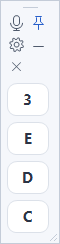

# MiniKeys · 迷你补键盘

**A small floating keypad for the few keys your physical keyboard can no longer type.**

[中文主页](README.md) · [Download the latest release](https://github.com/whynote/minikeys/releases/latest) · [Release history](CHANGELOG.en.md)

MiniKeys is a lightweight Windows utility that puts a few customizable keys on screen. It starts with **3, E, D, and C**, stays on top, and lets you keep typing in your current application by clicking those keys. A microphone button also invokes WeChat or Windows voice input.



The defaults are **Chinese interface, WeChat voice input, and a vertical four-key layout**, initially **60 × 244 pixels**. To use English, click the **gear**, select **English** in the language dropdown, and save. The change applies immediately and is remembered. Interface language and voice input method are separate settings.

## Download and run

1. Open the [latest release](https://github.com/whynote/minikeys/releases/latest), download `MiniKeys-v1.2.0-win-portable.zip`, and extract it.
2. Run `MiniKeys.exe`. No installation is required. The window stays on top by default.
3. Click the text field you want to type into, then click a key in MiniKeys.

MiniKeys sends keyboard events without taking focus away from the target text field. It works with the active keyboard layout and input method, including Chinese Pinyin. Letter labels are uppercase key names; letter case follows your physical Shift / Caps Lock state.

Designed for **Windows 10 / 11** with the **.NET Framework 4 family** runtime. No Java, Python, or third-party packages are required. Chinese Pinyin input, focus preservation, moving, and resizing have been tested on Windows 10. **Windows 11 has not been tested.**

## Features

- Choose **1–24 keys**, in your preferred order, with **1–12 columns**.
- Use one executable for both **WeChat voice input** and **Windows voice input**. WeChat is selected by default. The microphone is first in the toolbar, including narrow layouts.
- Switch between **Chinese and English** in settings, with immediate application after saving.
- A compact toolbar: microphone, pin, gear, minimize, and close. A blue pin means always on top is enabled.
- Configure idle fading: after the pointer has been outside for **4 seconds**, fade smoothly to **30% opacity** by default. Set opacity from **20% to 100%**, or turn fading off. Higher values keep the window clearer; hover or interact to restore full opacity immediately.
- Click keys while preserving the target application's input focus.
- Start with a narrow vertical layout. Toolbar icons wrap as the window gets narrower; keys resize with the window.
- Drag the small grip at the top to move the window; drag an edge or corner to resize it.
- Minimize to the taskbar and restore the previous position and size.
- Remember keys, layout, position, size, pinning, language, voice method, and fade settings.

## Settings

Click the **gear** to open settings. Key names are separated by spaces, for example:

```text
3 E D C Space Backspace
```

Set **keys per row** to `1` for a vertical stack, `4` for a four-key horizontal row, or `2` for two columns. The reset button restores `3 E D C` in one column. Save to apply your changes.

Select **English** for the interface language. This does not change the voice input method. Idle fading is enabled by default. A higher **idle opacity** value keeps the window clearer; 100% keeps it fully opaque. Fading is suspended while the WeChat shortcut is held.

Supported key names are case-insensitive:

| Type | Names |
| --- | --- |
| Letters and digits | `A`–`Z`, `0`–`9` |
| Function keys | `F1`–`F12` |
| Editing | `Space`, `Enter`, `Backspace`, `Tab`, `Esc`, `Delete` |
| Arrows and navigation | `Left`, `Right`, `Up`, `Down`, `Home`, `End`, `PageUp`, `PageDown` |
| Punctuation keys | `-`, `=`, `[`, `]`, `;`, `'`, `,`, `.`, `/`, `\`, and the backtick key |

Punctuation output follows your active keyboard layout and input method. Each key tile sends one key; you can hold physical Shift / Ctrl while clicking.

## Voice input

**WeChat voice input (default):** open and log in to a compatible desktop WeChat version, focus the target text field, and click the microphone. MiniKeys holds **Ctrl + Win**. Speak, then click again to release. Red means MiniKeys is holding the shortcut; it does not indicate that MiniKeys has detected WeChat's recording state. Keys are released before other keypad actions, settings, pinning, minimizing, moving/resizing, and normal exit. Release the shortcut before using your physical keyboard.

**Windows voice input:** select it in settings, focus the target text field, and click the microphone. Each click sends a complete **Win + H** shortcut. Windows manages listening state.

The user verified the previous local WeChat behavior. Voice input and recording were not triggered again for this release; Windows voice input has not been tested. See the bilingual [voice input guide](VOICE-INPUT.md) for shortcut sources and details.

## Window controls and troubleshooting

| Action | How |
| --- | --- |
| Move | Drag the small grip at the top |
| Resize | Drag an edge or the bottom-right corner |
| Toggle always on top | Click the pin; blue means pinned |
| Minimize | Click the short horizontal line |
| Restore or find the window | Click the taskbar icon |
| Change language, voice method, or fading | Click the gear |
| Exit | Click the cross |
| Reset everything | Close MiniKeys, delete `%LOCALAPPDATA%\MiniKeys\settings.json`, and launch it again |

After restoring from the taskbar, click the target text field before clicking a MiniKeys button. If keys do not reach an application, click its text field first. If the application runs as administrator, run MiniKeys with the same privileges.

To upgrade, close the old application and run the new version. Saved keys, window settings, voice method, and fading preferences are retained. Defaults apply on first launch or when a setting is missing; they do not replace saved choices. [Earlier releases](https://github.com/whynote/minikeys/releases) remain available.

MiniKeys uses Windows `SendInput` for keyboard events. It does not connect to the network, read or modify the clipboard, or monitor or log what you type. WeChat or Windows performs speech recognition. MiniKeys only sends shortcuts; it does not access the microphone or send chat messages. Settings are stored locally in `%LOCALAPPDATA%\MiniKeys\settings.json`.

## Build from source

Open PowerShell in the project directory and run:

```powershell
powershell -ExecutionPolicy Bypass -File .\build.ps1
```

Build without arguments to create the unified `MiniKeys.exe`; choose the voice input method in application settings. Source: [src/MiniKeys.cs](src/MiniKeys.cs). See the [English test guide](tests/README.en.md) for validation details. The image above is rendered from the application's controls; it is not a desktop screenshot and does not show transparency composition. Full desktop input and focus behavior after a real taskbar restore have not been rerun for this release.

This release passes 76 configuration and UI component checks without triggering voice input, covering defaults, migration, language changes, fading parameters, and compact layouts.

See [CHANGELOG.en.md](CHANGELOG.en.md) for version history. This project uses the [MIT license](LICENSE).
