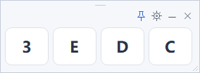

# 迷你补键盘 · MiniKeys

**把坏掉的几个按键，变成随手可点的悬浮按钮。**

[English documentation](README.en.md) · [下载最新版本](https://github.com/whynote/minikeys/releases/latest) · [中文版本说明](CHANGELOG.md) · [English release notes](CHANGELOG.en.md)

MiniKeys 是一个轻量的 Windows 悬浮补键工具。默认只显示 **3、E、D、C**，也可以换成自己需要的按键。开会或临时打字时，把它放在屏幕一角，用鼠标补上实体键盘失灵的按键。



竖排最窄四键布局（40 × 222 像素）：


> v1.1.0 随 Windows 显示语言自动使用中文或英文：中文系统显示中文，其余语言显示英文。项目主页以中文为主，另有[完整英文说明](README.en.md)。

## 下载与开始使用

1. 打开 [Releases 下载页](https://github.com/whynote/minikeys/releases/latest)，下载 `MiniKeys-v1.1.0-win-portable.zip` 并解压。
2. 双击 `MiniKeys.exe`。无需安装，默认置顶。
3. 先点击要输入的聊天框、文档或其他输入位置，再点击浮窗上的按键。

程序发送真实的按键事件，字母会交给当前输入法处理：中文模式下可继续打拼音，英文模式下输入英文字母。按钮显示的是大写键名，输入大小写跟随实体键盘的 Shift / Caps Lock 状态。

适用于 Windows 10 / 11，使用 Windows 的 .NET Framework 4 系列运行环境，不依赖 Java、Python 或第三方包。中文拼音、焦点保持、移动和缩放已在 Windows 10 实测；**Windows 11 尚未实测。**

## 可以做什么

- **只保留需要的键**：自定义 1–24 个按键及顺序，每行 1–12 个。
- **图标工具栏**：图钉控制置顶，齿轮打开设置，短横线最小化，叉号退出。蓝色图钉表示已置顶。
- **闲置淡化**：鼠标离开窗口 4 秒后，平滑淡至 65% 不透明度；移回鼠标或交互即恢复清晰。可在设置中关闭。
- **保持输入焦点**：点击补键时，原输入框继续接收按键。
- **窄条布局**：工具图标随窗口宽度自动折行；四键竖排已验证可缩至 **40 × 222 像素**。拖顶部短槽移动；拖窗口边缘或右下角缩放。
- **最小化与恢复**：暂时收起到任务栏，需要时点击任务栏图标恢复原位置和尺寸。
- **记住配置**：下次启动恢复按键、排列、位置、尺寸、置顶和淡化设置。

## 自定义按键

点击齿轮图标打开设置，在输入框中填写用空格分隔的按键，例如：

```text
3 E D C Space Backspace
```

“每行按键数”设为 `1` 即竖排，设为 `4` 即默认四键横排，设为 `2` 即两列。点击“保存”应用；“恢复 3 E D C”可恢复默认按键和排列。

设置中的闲置淡化开关默认开启。淡化只降低浮窗的透明度，按键仍然可见；鼠标回到窗口时立即恢复 100% 不透明度。淡化过渡约 0.4 秒。

支持以下按键，名称不区分大小写：

| 类型 | 可填写的名称 |
| --- | --- |
| 字母、数字 | `A`–`Z`、`0`–`9` |
| 功能键 | `F1`–`F12` |
| 编辑键 | `Space`、`Enter`、`Backspace`、`Tab`、`Esc`、`Delete` |
| 方向与导航 | `Left`、`Right`、`Up`、`Down`、`Home`、`End`、`PageUp`、`PageDown` |
| 英文标点 | `-`、`=`、`[`、`]`、`;`、`'`、`,`、`.`、`/`、`\`、反引号 |

标点结果跟随当前键盘布局及输入法。每个按钮发送单个按键，可配合实体键盘上的 Shift / Ctrl 使用。

## 常见操作与问题

| 需要做什么 | 操作 |
| --- | --- |
| 移动浮窗 | 拖动顶部短拖动槽 |
| 调整大小 | 拖动窗口边缘或右下角 |
| 取消或恢复置顶 | 点击图钉；蓝色表示已置顶 |
| 临时收起 | 点击短横线图标，最小化到任务栏 |
| 恢复或找回窗口 | 点击任务栏中的程序图标 |
| 自定义按键或关闭淡化 | 点击齿轮图标 |
| 退出 | 点击叉号图标 |
| 恢复全部默认设置 | 退出后删除 `%LOCALAPPDATA%\MiniKeys\settings.json`，再启动 |

从任务栏恢复后，先点击要输入的目标输入框，再点击补键。

从 v1.0.0 升级时，退出旧程序后运行新版即可；旧版按键与窗口配置会继续沿用，新增的闲置淡化默认开启。[v1.0.0 下载与历史说明](https://github.com/whynote/minikeys/releases/tag/v1.0.0)仍然保留。

如果点击按键没有输入，先点击目标输入框。若目标程序以管理员身份运行，补键盘也需要以相同权限运行。

程序通过 Windows `SendInput` 发送按下与松开事件，不联网，不读取或修改剪贴板，不监听或记录输入内容。配置只保存在本机的 `%LOCALAPPDATA%\MiniKeys\settings.json`。

## 从源码编译

在项目目录运行 PowerShell：

```powershell
powershell -ExecutionPolicy Bypass -File .\build.ps1
```

构建脚本使用 Windows 自带的 .NET Framework C# 编译器，生成 `MiniKeys.exe`。源码位于 [src/MiniKeys.cs](src/MiniKeys.cs)，测试说明见 [tests/README.md](tests/README.md)。

版本变化见 [CHANGELOG.md](CHANGELOG.md)。项目采用 [MIT 许可证](LICENSE)。

## 验证范围

v1.1.0 已通过 44 项无桌面自动检查，覆盖配置迁移、图标与紧凑布局、淡化及恢复、最小化时的位置尺寸保存。上方图片由程序组件绘制生成。实际鼠标输入与中文拼音已在 v1.0.0 的 Windows 10 测试中验证；本轮未重跑完整桌面输入测试，也未实测任务栏点击恢复后的焦点行为。中英文测试说明见 [tests/README.md](tests/README.md) 和 [tests/README.en.md](tests/README.en.md)。
